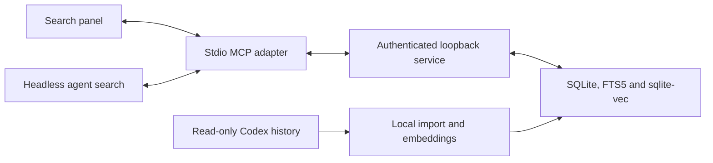

# Architecture

BetterSearch has a native search service, a thin stdio MCP adapter and a
conversation-panel UI.

## Search service

The C++20 service links llama.cpp directly. It imports visible user and assistant
messages from Codex SQLite history and JSONL/Zstandard rollouts. Source databases
are opened read-only. Automatic Guardian reviews are excluded by structured
origin metadata in state databases and rollout headers, never by title alone.
Already-indexed review copies are removed after backing up the search index;
unrelated scan warnings do not disable this explicit exclusion. Unsupported or unavailable sources retain their indexed
content and report errors; successful complete scans remove deleted chats.

The separate index uses schema version 1, SQLite WAL, FTS5 and 768-dimensional
sqlite-vec embeddings. Unsupported schemas are rejected without conversion.
Unchanged text reuses vectors. Rebuild and clear create consistent SQLite
backups. Source identifiers and item/turn IDs accompany retrieved passages.

Keyword and semantic candidates are fused into one completed ranking. Empty
queries return no results. Quoted phrases, project/date constraints and disabled
sources apply before ranking. Snippets contain original text rendered as text
nodes. Panel pagination uses immutable, memory-only snapshots of at most
100 chats, retained for up to ten minutes.

Query inference uses a warm CPU model separate from background indexing.
Optional local CUDA builds offload the first full document embedding build
and explicit rebuilds, with CPU
fallback on initialization or evaluation failure. Background jobs release their
index model when finished or paused, freeing its GPU resources. Query model
weights and operations stay on the CPU. A persisted completion marker keeps
later incremental embedding jobs on CPU across restarts.
Automatic scans run at startup and every 15 minutes, waiting for active indexing.
Failed semantic updates wait for an explicit retry. Resource profiles adjust
background batches and breaks.

## Model and runtime

Each platform release includes its native CPU service and a checksum-pinned
Node.js executable. Windows uses a ZIP with `.cmd` commands; Linux uses a tar.gz
with executable `.sh` commands and a GTK dialog helper. Platform-specific MCP
manifests are generated during packaging. It does not use the host application's internal runtime.
`scripts/runtime.mjs` defines the Node version and platform checksums.
Linux model jobs use `posix_spawn` with separate arguments and are terminated
and reaped when the service stops. GTK runs in a separate main-thread process;
Windows keeps the existing COM dialogs and CreateProcess-based model helper.

`scripts/model.mjs` pins the EmbeddingGemma 2 GGUF revision and SHA-256.
`scripts/model-cache.mjs` uses the central Hugging Face Hub cache, with verified
blobs and revision snapshots. It honors `HF_HUB_CACHE`, `HF_HOME` and
`XDG_CACHE_HOME`. Windows snapshots use hard links if symlinks are unavailable.
Downloads are explicit, serialized across plugin profiles, checked before
activation and cleaned after failure. No weights are stored in the plugin or
index directory.

The service launches the model helper with bundled Node and receives progress
through its own data directory. Closing an adapter does not cancel the job.
A completed download activates the model path and schedules missing embeddings.
Pooling, retrieval prefixes, normalization and dimensions are fixed.

## MCP and panel

The adapter starts or reuses one service at `127.0.0.1:39471`. The service checks
identity/version, bearer authentication, Host and Origin. It exposes health and
JSON API routes, with no browser application. Closing one stdio connection leaves
the shared service running; explicit authenticated shutdown stops it.

Agent tools are `search_chats`, `search_status` and `open_search`.
Panel search, filters, settings and index maintenance are app-only operations.
Disabling agent retrieval is enforced by the service and preserves panel search.

The panel has one thread entrypoint. It uses the host's MCP Apps bridge for
tools and validated original-chat links. Its controller discards stale replies
and preserves completed results through Settings. All product text comes from
`locales/en.json`. Retrieved text is untrusted historical data; excerpts requested
by an agent become context for its current conversation.

## Source layout

- `native/`: storage, source import, retrieval, inference and settings.
- `src/`: service launcher, MCP adapter and panel.
- `scripts/`: dependency setup, runtime/model download, packaging and verification.
- `tests/`: synthetic source, service, protocol and UI checks.

Host APIs and Codex's internal history formats can change. Verify compatibility
against the intended desktop version before publishing a release.
